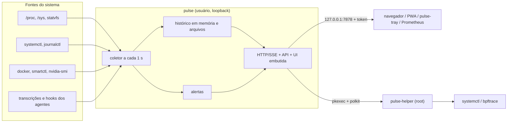

# Pulse

Monitor do Ubuntu com painel de agentes de IA: um daemon leve em Rust (só biblioteca padrão) que serve
um painel web local em `http://127.0.0.1:7878`.

[](https://github.com/JoaoVictorAAbreu-Dev/pulse-linux-monitor/actions/workflows/ci.yml)
[](https://github.com/JoaoVictorAAbreu-Dev/pulse-linux-monitor/releases/latest)
[](LICENSE)

<p align="center"></p>

## Sumário

- [Apresentação](#apresentação)
- [Destaques](#destaques)
- [Instalação rápida](#instalação-rápida)
- [Primeiros passos](#primeiros-passos)
- [Como funciona](#como-funciona)
- [Telas](#telas)
- [Agentes de IA](#agentes-de-ia)
- [Configuração](#configuração)
- [Integrações](#integrações)
- [Segurança](#segurança)
- [API](#api)
- [Compilar a partir do código](#compilar-a-partir-do-código)
- [Validação](#validação)
- [Limitações conhecidas](#limitações-conhecidas)
- [Roadmap](#roadmap)
- [Licença](#licença)

## Apresentação

[](docs/media/pulse-apresentacao.mp4)

*Clique na imagem para ver o vídeo (51 s, sem áudio). Gravado com [HyperFrames](https://github.com/heygen-com/hyperframes) a partir de telas reais do Pulse, com dados de demonstração: usuário, máquina e projetos fictícios.*

## Destaques

- **Sistema inteiro numa tela**: CPU, GPU, memória, swap, discos, processos, serviços systemd, timers,
  cron, contêineres Docker, rede, logs e alertas, com histórico de até 90 dias.
- **Painel de agentes de IA**: Claude Code, Codex e OpenClaw/"Ponto", com servidores MCP, sessões,
  ritmo, latência por ferramenta, tokens por dia, custo estimado e eventos ao vivo por hooks.
- **Privacidade**: das transcrições só saem metadados; o texto de pedidos, respostas e argumentos de
  ferramentas nunca sai do daemon.
- **Leve e sem dependências**: Rust só com a biblioteca padrão, sem crates externas; recursos extras usam
  comandos externos opcionais (`smartctl`, `docker`, `bpftrace`, `nvidia-smi`…).
- **Seguro por padrão**: escuta só no loopback, exige token, ações sensíveis com confirmação e auditoria;
  o que exige root passa por um helper próprio via `pkexec`/polkit.
- **Integrações**: `/metrics` para Prometheus/Grafana, notificações (desktop, ntfy, webhook, Discord,
  Telegram), PWA, ícone na bandeja e várias máquinas (somente leitura) por túnel SSH.

## Instalação rápida

Pacote `.deb` para **Ubuntu 24.04+ / Debian com glibc ≥ 2.39**, em amd64 e arm64, na
[página de Releases](https://github.com/JoaoVictorAAbreu-Dev/pulse-linux-monitor/releases/latest).

```sh
# 1. Baixe o pacote (troque amd64 por arm64 se for o caso) e confira o checksum
curl -LO https://github.com/JoaoVictorAAbreu-Dev/pulse-linux-monitor/releases/download/v0.5.1/pulse-monitor_0.5.1_amd64.deb
curl -LO https://github.com/JoaoVictorAAbreu-Dev/pulse-linux-monitor/releases/download/v0.5.1/SHA256SUMS
sha256sum -c SHA256SUMS --ignore-missing

# 2. Instale e habilite o serviço de usuário
sudo apt install ./pulse-monitor_0.5.1_amd64.deb
systemctl --user daemon-reload && systemctl --user enable --now pulse

# 3. Abra o painel
pulse-open              # abre no navegador padrão (inicia o serviço se preciso)
pulse --print-token     # ou: imprime a URL de acesso, com o token no fragmento #
```

O serviço **não** é habilitado automaticamente para todos os usuários: cada usuário roda o
`systemctl --user enable --now pulse`.

<details>
<summary>O que o pacote instala e dependências opcionais</summary>

- `/usr/bin/pulse`, `/usr/bin/pulse-hook`, `/usr/bin/pulse-open` e `/usr/bin/pulse-tray`;
- `/usr/libexec/pulse-monitor/pulse-helper` e a política polkit `io.github.pulse-monitor.policy`;
- o serviço de usuário `/usr/lib/systemd/user/pulse.service`;
- man pages, autocompletar do bash, exemplos de `config.toml` e `agents.conf` em
  `/usr/share/pulse-monitor/`, o atalho **Pulse** no menu de aplicativos e o ícone.

Dependências do pacote: `systemd` e `python3`. Recomendados: `curl` (usado pelo `pulse-hook` e pelas
notificações externas), `libnotify-bin` (`notify-send`) e `python3-gi` (`pulse-tray`). Sugeridos, para
recursos opcionais: `docker.io`, `xdg-utils`, `bpftrace`, `smartmontools` e `openssh-client`. As sessões
do OpenClaw usam o programa `sqlite3`, se instalado.

</details>

<details>
<summary>Instalação sem pacote (<code>install.sh</code>, em <code>~/.local/bin</code>)</summary>

Requisitos: Rust estável (`rustup`) e `curl` (para o `pulse-hook`).

```sh
./install.sh            # compila em release e instala pulse e pulse-hook em ~/.local/bin
./install.sh --enable   # também habilita o serviço systemd de usuário
pulse --print-token     # imprime a URL de acesso
```

Se você usou o `install.sh` e depois instalou o pacote, a unidade em `~/.config/systemd/user/` tem
prioridade; remova-a (e `~/.local/bin/pulse*`) para usar a versão do pacote.

</details>

## Primeiros passos

1. Abra o painel com `pulse-open` ou com a URL de `pulse --print-token`. O token vai no fragmento
   (`#token=…`); a interface o troca por um cookie e limpa a barra de endereço.
2. Navegue pelas telas com o menu ou com o teclado: `g` + `v/c/m/d/p/s/r/l/a/x` troca de tela, `/` busca,
   `t` alterna o tema e `?` mostra a ajuda.
3. Na tela **Agentes**, use **Conectar hooks** para receber eventos do Claude Code ao vivo (detalhes em
   [Agentes de IA](#agentes-de-ia)).
4. Na tela **Alertas**, ajuste os limiares ("Editar limiares") e, se quiser, os canais externos.
5. Opcional: `pulse-tray --install-autostart` coloca o ícone na bandeja a cada sessão, e no
   Chrome/Brave/Edge dá para instalar o painel como app (PWA).

Comandos úteis:

```sh
systemctl --user status pulse     # estado do serviço
journalctl --user -u pulse        # log do serviço (inclui avisos do config.toml)
pulse --once                      # imprime um snapshot JSON e sai
pulse --rotate-token              # troca o token sem reiniciar o serviço
```

## Como funciona

O Pulse é um workspace Cargo com três crates e alguns scripts de apoio:

| Componente | Papel |
|---|---|
| `crates/pulse-core` | coletores (`/proc`, `/sys`, `statvfs`, `systemctl`, `journalctl`), JSON, histórico, alertas |
| `crates/pulse-agents` | detecção de agentes, servidores MCP, transcrições e hooks |
| `crates/pulse-daemon` | HTTP/SSE, autenticação, API e UI embutida no binário (`include_str!`); binários `pulse` e `pulse-helper` |
| `packaging/` | `pulse.service`, `pulse-hook`, `pulse-tray`, `agents.conf.example`, `config.toml.example`, `build-deb.sh`, `deb/` |
| `assets/logo/` | marca, ícone de app, versões mono e lockup |



- **Coleta**: o daemon roda como seu usuário e amostra o sistema no intervalo configurado (padrão
  1000 ms, mínimo 250 ms). Recursos opcionais chamam comandos externos só quando existem.
- **Entrega**: a UI estática fica embutida no binário; os dados chegam pela API JSON e por SSE
  (`event: snapshot` a cada amostra e `event: hook` para eventos de agentes).
- **Privilégios**: o que exige root (ações em serviços do sistema e a medição eBPF) passa pelo
  `pulse-helper` via `pkexec`, com senha pedida pelo polkit. Veja [Segurança](#segurança).
- **Persistência**: arquivos só-anexar em `~/.local/state/pulse/`, sem banco de dados.

<details>
<summary>Histórico longo e arquivos de estado</summary>

- **Ao vivo**: anel de 900 pontos (15 min a 1 s) em memória.
- **1 min**: `LongStore` (`pulse-core::longterm`) agrega as amostras em médias de 60 s
  (`bucket = ts / 60_000`, `ts` em ms), retém 7 dias (10 080 pontos) por padrão e grava em
  `~/.local/state/pulse/history.log`. A retenção é configurável (`[history] retention_days`, até 90 dias).
- **15 min**: `history-15m.log` guarda médias de 15 min por 90 dias (preenchida a partir da camada de
  1 min na primeira execução) e atende às faixas de 30 e 90 dias.
- Linhas inválidas são ignoradas ao carregar; quando o arquivo passa de 2× a capacidade, é compactado via
  arquivo temporário + `rename`. Erros de E/S ficam em `/api/health` (`long_error`) e nunca derrubam o
  daemon.
- Eventos de hooks e o histórico de alertas também persistem (`hooks.log` e `alerts.log`, últimos 300 de
  cada, mesmo esquema só-anexar com compactação) e são recarregados ao reiniciar o serviço.
- A auditoria de ações sensíveis fica em `~/.local/state/pulse/audit.log` (0600).

</details>

## Telas

| # | Tela | O que mostra |
|---|---|---|
| 1 | **Visão geral** | KPIs (CPU, memória, swap, disco, rede ↓/↑, temperatura), gráfico CPU/memória, alertas, maiores consumidores, agentes agora e armazenamento |
| 2 | **CPU** | histórico, usuário/sistema/iowait, carga, PSI, governor, núcleos e sensores; **GPU** e **energia** |
| 3 | **Memória** | composição, swap, PSI, mortes por OOM e **quem está na swap** |
| 4 | **Discos** | sistemas de arquivos, dispositivos, **SMART** opcional, explorador de espaço e candidatos à limpeza |
| 5 | **Processos** | tabela ou árvore, E/S por processo, encerrar/pausar/continuar/renice com confirmação |
| 6 | **Serviços** | systemd de usuário e de sistema, timers, CPU/memória por unidade, cron e contêineres Docker |
| 7 | **Rede** | tráfego, conexões TCP, interfaces, portas em escuta e **tráfego por processo (eBPF)** sob demanda |
| 8 | **Logs** | journalctl (sistema/usuário) com filtros, busca e "seguir" |
| 9 | **Agentes** | processos de agentes, MCP, sessões, ritmo, latência, tokens, custo e eventos ao vivo |
| 10 | **Alertas** | ativos, regras, histórico e status das notificações |

<details>
<summary>Detalhes de cada tela</summary>

1. **Visão geral** — gráfico em 15 min ao vivo ou 1 h / 24 h / 7 d em médias de 1 min e 30 d / 90 d em
   médias de 15 min; nas faixas de 1 h, 24 h e 7 d dá para sobrepor o período anterior (hora anterior,
   ontem ou semana anterior).
2. **CPU** — carga 1/5/15, trocas de contexto, núcleos com frequência; **GPU** (uso, VRAM/GTT,
   frequência, temperatura e potência via amdgpu/i915 no `/sys/class/drm`, ou `nvidia-smi`); **energia**
   (baterias com saúde e tempo restante; consumo da CPU via RAPL quando legível).
3. **Memória** — composição (apps/cache/livre), swap, shmem, páginas sujas, swappiness, mortes por OOM,
   PSI, histórico, maiores consumidores e `VmSwap` por processo.
4. **Discos** — uso e inodes por sistema de arquivos; throughput, IOPS e ocupação por dispositivo; gráfico
   de throughput; **saúde SMART** opcional (via `smartctl`, sob demanda; o número de série nunca é
   exposto); explorador "o que ocupa espaço?" **em segundo plano** (com progresso, cache de 5 min e
   prioridade baixa) e candidatos à limpeza (**apenas listados com o comando sugerido; o Pulse nunca os
   executa**).
5. **Processos** — tabela filtrável/ordenável com **E/S de disco por processo** (`/proc/PID/io`) e
   **visão em árvore** (CPU e RSS somados por subárvore); encerrar (SIGTERM → SIGKILL após 5 s),
   pausar/continuar e prioridade (renice), sempre com confirmação.
6. **Serviços** — filtros, busca, iniciar/parar/reiniciar; timers do systemd (próxima/última execução);
   **CPU e memória por unidade** a partir do cgroup v2 (sem root); botão **Logs** que abre a tela Logs
   filtrada pela unidade. No escopo do sistema as ações passam pelo `pulse-helper` via `pkexec` (janela de
   senha do polkit, autorização mantida por alguns minutos). Cron: crontab do usuário, `/etc/crontab`,
   `/etc/cron.d` e `cron.{daily,...}`, com variáveis ocultas e senhas/tokens mascarados. Contêineres
   Docker: estado, portas, CPU/memória sob demanda (ou pelo cgroup, sem `docker stats`), **logs do
   contêiner** e iniciar/parar/reiniciar com confirmação e auditoria.
7. **Rede** — ↓/↑, conexões TCP por estado, interfaces e portas em escuta com processo dono e marca
   "só local" / "acessível na rede"; **tráfego por processo (eBPF)**: 5, 10 ou 30 s de medição com
   `bpftrace` (bytes TCP/UDP enviados e recebidos por processo e latência média/máxima dos discos), com
   senha via polkit.
8. **Logs** — journalctl (sistema/usuário), unidade, prioridade, nº de linhas, busca e "seguir".
9. **Agentes** — veja [Agentes de IA](#agentes-de-ia).
10. **Alertas** — ativos, regras, histórico, edição dos limiares, canais externos e status da notificação
    no desktop.

</details>

## Agentes de IA

A tela **Agentes** é o diferencial do Pulse: processos de agentes (Claude Code, Codex, OpenClaw/"Ponto" e
regras de `agents.conf`), servidores MCP filhos, sessões com **ritmo** (tempo ativo e tempo esperando
você), **latência por ferramenta** e **custo estimado**, **uso diário de tokens em 30 dias** por agente e
modelo, e eventos ao vivo por hooks (subagentes, falhas de ferramenta, pedidos de permissão; Codex com
"executando" inferido pela transcrição).

- **Processos**: casam por nome do executável ou trecho da linha de comando. Regras extras em
  `~/.config/pulse/agents.conf` (veja [`packaging/agents.conf.example`](packaging/agents.conf.example)).
  O app Claude Desktop não é contado.
- **Servidores MCP**: descendentes de um agente cujo executável/script tem `mcp` no nome (shells que apenas
  mencionam "mcp" num comando são ignorados).
- **Sessões**: `~/.claude/projects/*/*.jsonl` (Claude Code) e `~/.codex/sessions/**/*.jsonl` (Codex),
  últimas 16 sessões dos últimos 3 dias. Por privacidade, só metadados são expostos — projeto, modelo,
  nomes de ferramentas, tokens e linha do tempo. **O texto de pedidos, respostas e argumentos de
  ferramentas nunca sai do daemon.**
- **Hooks do Claude Code**: o botão **Conectar hooks** mescla em `~/.claude/settings.json` (com backup
  `settings.json.pulse-bak`, idempotente; reinstalar só acrescenta os eventos que faltam) chamadas a
  `pulse-hook` para `UserPromptSubmit`/`PreToolUse` (executando), `PermissionRequest`/`Notification`
  (pedindo atenção), `PostToolUseFailure` (falha de ferramenta), `SubagentStart`/`SubagentStop`
  (subagentes), `Stop` (aguardando) e `SessionEnd` (concluído).
- **Codex**: o diálogo mostra a linha `notify = ["…/pulse-hook", "aguardando", "codex"]` para o início de
  `~/.codex/config.toml` (o Codex passa o JSON como argumento; o `pulse-hook` aceita os dois formatos).
  O Pulse não edita esse TOML sozinho.
- **OpenClaw**: as sessões ficam em SQLite (`~/.openclaw/agents/*/agent/openclaw-agent.sqlite`) e são
  lidas em modo somente leitura pelo programa `sqlite3`, se instalado (`sudo apt install sqlite3`); só
  janela da sessão, contagem de mensagens e modelo.
- **Outros agentes**: `echo '{"session_id":"x"}' | pulse-hook aguardando openclaw`. O script nunca
  bloqueia o agente (tempo limite de 2 s, sai sempre com 0) e passa o token ao `curl` pela entrada padrão,
  não pela linha de comando.
- **Aviso de atenção**: quando um agente pede atenção, o Pulse avisa no desktop (`notify-send`), no máximo
  1 vez por minuto por sessão. Desligue em **Preferências** ou com `[agents] notify_attention = false`.
- **Custo**: cadastre preços (US$ por milhão de tokens: entrada, saída, leitura e escrita de cache) em
  **Preferências** ou em `[prices]` no `config.toml`. O Pulse **não traz preços prontos** — confira os
  valores atuais no site de cada provedor. Um modelo casa pelo nome exato ou pelo prefixo mais longo.
  O uso diário vem de um índice das transcrições dos últimos 30 dias, reconstruído a cada 5 min (só
  arquivos alterados são relidos).
- **Modo detalhado (opt-in)**: `[agents] show_tool_details = true` mostra comando, caminho ou padrão de
  cada ferramenta na linha do tempo e nos eventos ao vivo, com valores que parecem senhas/tokens
  mascarados. Conteúdo de arquivos, patches e o texto das conversas continuam fora.

## Configuração

### Linha de comando

```
pulse [--port 7878] [--bind 127.0.0.1] [--allow-remote] [--interval-ms 1000]
      [--notify] [--no-agents] [--config ARQ]
pulse --once | --print-token | --rotate-token | --print-config | -h
```

| Flag | Efeito |
|---|---|
| `--port N` | porta HTTP (padrão 7878) |
| `--bind IP` | endereço de escuta; fora do loopback exige `--allow-remote` |
| `--interval-ms N` | intervalo do coletor (padrão 1000, mínimo 250) |
| `--notify` | alertas novos vão para o desktop via `notify-send` |
| `--no-agents` | desliga detecção de agentes, sessões e hooks |
| `--config ARQ` | arquivo de configuração (padrão `~/.config/pulse/config.toml`) |
| `--print-token` | imprime a URL de acesso e sai |
| `--once` | coleta duas amostras, imprime o snapshot JSON e sai |
| `--rotate-token` | gera um token novo; o daemon em execução o adota em até 3 s |
| `--print-config` | imprime um `config.toml` de exemplo comentado |

### Arquivo `config.toml`

`~/.config/pulse/config.toml` (subconjunto de TOML). Precedência: padrões < arquivo < flags. O exemplo
completo e comentado está em [`packaging/config.toml.example`](packaging/config.toml.example) (também
saída de `pulse --print-config`).

```toml
port = 7878
interval_ms = 1000
notify = false

[history]
retention_days = 7      # 1 a 90 dias de médias de 60 s

[alerts]
cpu_pct = 90            # CPU acima disso…
cpu_samples = 30        # …por N amostras seguidas
mem_warn = 90
mem_crit = 96
disk_warn = 90
disk_crit = 97
temp_crit = 88          # °C
```

- Os limiares também podem ser editados na tela **Alertas** ("Editar limiares"): o Pulse reescreve só a
  seção `[alerts]`, preservando comentários e o resto do arquivo, e a mudança vale na hora.
- Linhas inválidas viram avisos (no log do serviço e em `GET /api/config`) e não impedem o daemon de subir.
- Outras seções: `[agents]` e `[prices]` ([Agentes de IA](#agentes-de-ia)), `[notify]` e `[remote.NOME]`
  ([Integrações](#integrações)).

## Integrações

### Prometheus / Grafana

`GET /metrics` no formato de texto do Prometheus: CPU por modo e núcleo, carga, PSI, memória, swap,
sistemas de arquivos, discos, rede, temperaturas, GPU, processos, alertas, agentes e tokens de hoje por
modelo. Autentique com `Authorization: Bearer <token>`:

```yaml
scrape_configs:
  - job_name: pulse
    static_configs: [{ targets: ["127.0.0.1:7878"] }]
    authorization: { credentials_file: /home/VOCÊ/.config/pulse/token }
```

### Notificações

- **Desktop**: `--notify` (ou `notify = true`) envia alertas novos via `notify-send`.
- **Canais externos** (`[notify]` ou tela Alertas → Canais externos): ntfy (com token opcional), webhook
  JSON genérico ou do Discord, e Telegram. Alertas são encaminhados por padrão; "agente pedindo atenção" é
  opcional. O envio usa o `curl` com URL e segredos pela entrada padrão (nada na linha de comando ou nos
  logs); títulos com acento vão em RFC 2047 no ntfy. Tópicos do ntfy.sh são públicos para quem souber o
  nome: use um nome longo e aleatório.

### App (PWA) e atalhos

No Chrome/Brave/Edge, "Instalar Pulse" na barra de endereço. O service worker não guarda dados do sistema
offline. Atalhos: `g` + `v/c/m/d/p/s/r/l/a/x` navega entre as telas, `/` busca, `t` alterna o tema, `?`
mostra a ajuda.

### Ícone na bandeja

`pulse-tray` mostra CPU/memória no rótulo e alertas e agentes no menu; um clique abre o painel.
`pulse-tray --install-autostart` inicia junto com a sessão. Usa o protocolo StatusNotifierItem direto pelo
D-Bus (python3-gi/Gio), sem GTK; no GNOME depende da extensão de AppIndicators (padrão no Ubuntu).

### Várias máquinas (somente leitura)

Cada `[remote.NOME]` no `config.toml` aparece num seletor no topo da interface.

- Com `ssh = "usuario@host"`, o Pulse mantém um túnel `ssh -L` supervisionado (reconecta sozinho, com
  espera crescente) até o Pulse da outra máquina, que continua só no loopback dela.
- Com `url = "http://127.0.0.1:PORTA"`, ele usa um túnel que você já mantém.
- Precisa do token da outra máquina (`token = "…"`), que fica só no seu `config.toml` e nunca é devolvido
  pela API.
- Ações (sinais, serviços, contêineres) são recusadas na máquina remota: abra o Pulse dela para isso.

```toml
[remote.servidor]
ssh = "ana@192.168.1.20"          # chave sem senha ou ssh-agent; BatchMode, sem prompt
ssh_key = "/home/ana/.ssh/id_ed25519"
token = "<conteúdo de ~/.config/pulse/token no servidor>"
```

### Hooks de agentes

O `pulse-hook` recebe eventos do Claude Code (instalação pelo botão **Conectar hooks**), do Codex (linha
`notify` para colar) e de qualquer outro agente que consiga chamar um comando. Detalhes em
[Agentes de IA](#agentes-de-ia).

## Segurança

- Escuta só em `127.0.0.1`; `--bind` fora do loopback exige `--allow-remote`.
- Token aleatório de 256 bits em `~/.config/pulse/token` (arquivo 0600, diretório 0700). Comparado em
  tempo constante; nunca aparece em logs nem em respostas.
- O navegador recebe um cookie `HttpOnly; SameSite=Strict`. `GET` aceita cookie ou o cabeçalho
  `X-Pulse-Token`; `POST` **exige** o cabeçalho.
- `Host` é validado (DNS rebinding) e `Origin`, quando presente, também (CSRF).
- Após 10 tentativas com token errado em 10 minutos, o IP fica bloqueado por 5 minutos (HTTP 429,
  registrado como `auth.block` na auditoria); cada falha também atrasa a resposta progressivamente.
- `pulse --rotate-token` troca o token sem reiniciar o serviço (cookies antigos deixam de valer).
- A URL de `--print-token` leva o token no fragmento (`#token=…`), que não é enviado ao servidor; a UI o
  troca por um cookie e limpa a barra de endereço.
- Cabeçalhos de segurança: CSP restritiva, `X-Frame-Options: DENY`, `nosniff`, `no-referrer`.
- Ações sensíveis (sinais em processos, ações em serviços e contêineres, instalação de hooks) vão para
  `~/.local/state/pulse/audit.log` (0600). PID 1 e o próprio Pulse são protegidos; antes do SIGKILL o
  Pulse confere se o PID não foi reutilizado.
- **Privilégios**: o daemon roda como seu usuário. O que exige root passa pelo `pulse-helper`
  (`/usr/libexec/pulse-monitor/`), executado via `pkexec` com a política
  `io.github.pulse-monitor.policy` (`auth_admin_keep`, só sessão ativa). O helper aceita apenas
  `unit start|stop|restart <nome>.service` e `netprobe <1..30>` (script bpftrace fixo), limpa o ambiente e
  chama `/usr/bin/systemctl` e `/usr/bin/bpftrace` por caminho absoluto. Por isso o `pulse.service` não
  usa `NoNewPrivileges` (o `pkexec` é setuid).
- **Máquinas remotas**: o túnel liga `127.0.0.1` local a `127.0.0.1` remoto (nada exposto na rede), o
  repasse só aceita `GET` em `/api/…` e usa o token da outra máquina, nunca o seu.
- Sem TLS: o painel foi pensado para loopback. Com `--allow-remote`, use um túnel (SSH) ou proxy com TLS.

## API

Todas as rotas exigem autenticação, exceto a UI estática, `GET /api/health` (mínima), `POST /api/login`
e `POST /api/logout`.

| Rota | Descrição |
|---|---|
| `GET /api/health` | estado do daemon (sem dados do sistema) |
| `POST /api/login` · `POST /api/logout` | troca o token por cookie de sessão / encerra a sessão |
| `GET /api/snapshot` | última amostra completa |
| `GET /api/history` | anel de 900 pontos (15 min a 1 s), formato colunar |
| `GET /api/history/long?range=1h\|6h\|24h\|7d\|30d\|90d` | histórico longo (médias de 1 min; 15 min nas faixas de 30 e 90 dias) |
| `GET /api/stream` | SSE: `event: snapshot` a cada amostra e `event: hook` |
| `GET /api/processes` · `POST /api/processes/{pid}/{terminate\|kill\|pause\|resume\|renice}` | processos |
| `GET /api/services?scope=user\|system` · `POST /api/services/action` | systemd |
| `GET /api/logs?scope=&unit=&priority=&lines=&q=&cursor=` | journald |
| `GET /api/timers?scope=user\|system` · `GET /api/cron` | agendamentos |
| `GET /api/cgroups` | CPU/memória por unidade systemd e contêiner (cgroup v2) |
| `GET /api/containers[?stats=1]` · `POST /api/containers/action` | Docker |
| `GET /api/containers/logs?id=&lines=` | últimas linhas de log de um contêiner |
| `GET /api/disk/usage?path=&refresh=1` | explorador de espaço em segundo plano (`pending` + progresso, depois o resultado) |
| `GET /api/disk/cleanup` | candidatos à limpeza (só listados) |
| `GET /api/disk/smart` | saúde dos discos via `smartctl` (opcional) |
| `GET /api/agents` · `GET /api/agents/hooks` · `POST /api/agents/hooks/install` · `POST /api/agents/hook` | agentes |
| `GET /api/alerts` | alertas ativos, histórico e regras |
| `GET /api/config` · `POST /api/config/alerts` | configuração efetiva e edição dos limiares |
| `POST /api/config/agents` | grava `[agents]` e `[prices]` (tela Preferências) |
| `GET /api/config/notify` · `POST /api/config/notify` · `POST /api/notify/test` | canais externos (sem devolver segredos) |
| `GET /metrics` | exposição para o Prometheus (aceita `Authorization: Bearer`; também em `/api/metrics`) |
| `POST /api/probe/net` `{"seconds":1..30}` | medição eBPF sob demanda (pede senha via polkit; 501 sem o helper) |
| `GET /api/remotes` | máquinas configuradas e estado (`conectando`, `ok`, `erro`), sem tokens |
| `GET /api/remote/{nome}/api/…` | repasse somente leitura para o Pulse de outra máquina (inclui SSE); outros métodos → 405 |

## Compilar a partir do código

Requisitos: Rust estável (`rustup`). Sem crates externas.

```sh
cargo build && cargo test
cargo run -p pulse-daemon -- --port 7979 --interval-ms 500
```

Gerar o `.deb` localmente (usa `dpkg-deb` e `fakeroot`, sem `cargo-deb`):

```sh
packaging/build-deb.sh                                      # target/deb/pulse-monitor_<versão>_<arq>.deb
packaging/build-deb.sh --no-build                           # empacota o binário já compilado
packaging/build-deb.sh --target aarch64-unknown-linux-gnu   # arm64 (precisa de gcc-aarch64-linux-gnu)
sudo apt install ./target/deb/pulse-monitor_0.5.1_amd64.deb
```

Princípios do projeto (do [ROADMAP](ROADMAP.md)): só biblioteca padrão no daemon (dependências opcionais
ficam atrás de comandos externos), loopback + token por padrão, nada destrutivo sem confirmação e
auditoria, e nunca expor conteúdo de conversas dos agentes.

## Validação

- **CI (GitHub Actions)**: `cargo fmt --check`, `clippy -D warnings`, testes, sintaxe da UI e dos
  scripts; depois gera os `.deb` amd64 e arm64, roda `lintian --fail-on warning` e instala/remove o pacote
  amd64. Em tags `v*`, publica uma Release com os `.deb` e `SHA256SUMS`.
- **`cargo test`**: 108 testes unitários + 14 de integração (`crates/pulse-daemon/tests/api.rs`), que
  sobem o binário real com HOME/XDG temporários e cobrem autenticação, Host/Origin, SSE, persistência
  entre reinícios, arquivo de configuração, rotação do token, bloqueio por força bruta, a CLI e o repasse
  para outra máquina (dois daemons: GET com query, SSE, POST → 405, máquina desconhecida → 404, token
  remoto nunca exposto).
- **Daemon real**: rotas, autenticação (401/421/403), SSE, `--once`, reinício com recarga do histórico
  longo.
- **Interface**: conferida em Chromium headless (1440×900, claro/escuro e 390 px): sem erros de
  JavaScript, sem tabelas/textos transbordando e sem rolagem horizontal no celular.

<details>
<summary>Histórico</summary>

Antes da Fase 1 eram 62 testes (coletores com amostras sintéticas, JSON, histórico longo — agregação em
ms, recarga, linhas inválidas, compactação, falhas de E/S —, alertas, auth, HTTP, hooks, transcrições,
cron/Docker). O status de validação de cada fase está no [ROADMAP](ROADMAP.md).

</details>

## Limitações conhecidas

O que **não** foi feito ou **não** foi testado de ponta a ponta:

- **Interface em inglês (roadmap 4.5)**: ainda não; a UI é só em pt-BR.
- **Tauri**: não há app nativo; a interface web pode ser instalada como PWA e há o `pulse-tray`
  (Python + D-Bus).
- **SQLite**: decisão de **não usar** (veja a Fase 5 do [ROADMAP](ROADMAP.md)): as consultas do histórico
  continuam simples e os arquivos texto bastam.
- **Sem TLS**: pensado para loopback (veja [Segurança](#segurança)).
- **Telegram e Discord**: implementados, mas só testados com um receptor HTTP local (formato das
  requisições), não contra os serviços reais. O ntfy e o webhook JSON foram testados de ponta a ponta com
  um receptor local.
- **SMART**: implementado via `smartctl`, mas **não testado em hardware real** (o smartmontools não está
  instalado na máquina de desenvolvimento; só o parser foi testado com saídas de exemplo). Ler SMART
  normalmente exige root ou o grupo `disk`.
- **RAPL e bateria**: o consumo da CPU só aparece se `/sys/class/powercap/intel-rapl:0/energy_uj` for
  legível; em kernels recentes ele é restrito ao root. Bateria só testada com dados de exemplo (máquina
  desktop).
- **eBPF**: só sob demanda (não é contínuo) e só TCP/UDP enviados (`tcp_sendmsg`/`udp_sendmsg`) e TCP
  recebidos (`tcp_cleanup_rbuf`); UDP recebido fica de fora. Precisa do pacote `bpftrace` e de root (via
  polkit). Testado em contêiner privilegiado no kernel 7.0.
- **Helper polkit**: o helper foi testado direto como root (num contêiner). Com a 0.5.0 instalada, o
  `pkexec` falhou com "pkexec must be setuid root" porque o `pulse.service` tinha `NoNewPrivileges=yes`;
  a 0.5.1 tira essa opção (e, se o pkexec continuar bloqueado, as ações em serviços caem no `systemctl`,
  que pede autorização ao polkit pelo D-Bus). Conferido em 22/11/2026 com a 0.5.1 instalada no Ubuntu: a
  janela de senha abriu e o `pkexec` executou o helper para reiniciar o `cron` e para a medição eBPF.
- **Várias máquinas**: testado com dois daemons locais (modo `url`) e com um contêiner com `sshd` (modo
  `ssh`, incluindo queda e reconexão do túnel); não com máquinas físicas diferentes. A remota é só leitura
  e o histórico longo/agentes vêm dela, mas preferências e alertas editáveis não.
- **Docker**: só via CLI `docker` (precisa do usuário no grupo `docker`); sem Podman.
- **Sessões do OpenClaw/"Ponto"**: leitura implementada via `sqlite3`, mas o programa não está instalado
  na máquina de desenvolvimento; a consulta SQL foi validada contra os bancos reais (pelo módulo sqlite3
  do Python) e o parser com saídas de exemplo.
- **Hooks do Codex/OpenClaw**: sem instalação automática (o trecho do Codex é exibido para colar).
- **Argumentos de ferramentas**: por privacidade, a tela Agentes mostra só **nomes** de ferramentas, não
  argumentos (o mock do Figma mostra comandos como `npm test`; isso foi uma decisão consciente). O modo
  detalhado é opt-in.
- **Portas de outros usuários**: processos de outros usuários aparecem sem dono nas portas em escuta
  (exigiria root).

## Roadmap

O plano por fases, com o status de validação de cada item e o que ainda está pendente (por exemplo, 1.7
repositório APT/PPA e 4.5 interface em inglês), está em [ROADMAP.md](ROADMAP.md).

## Licença

[MIT](LICENSE).
